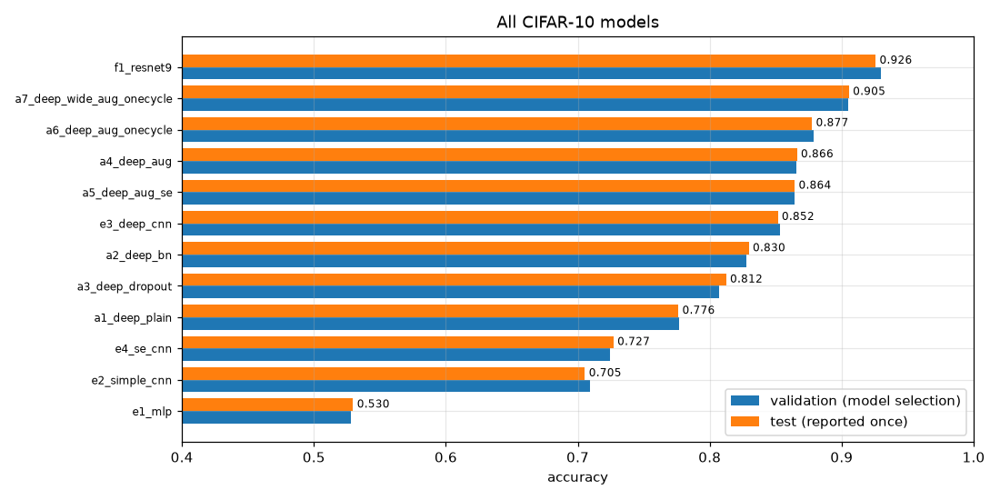
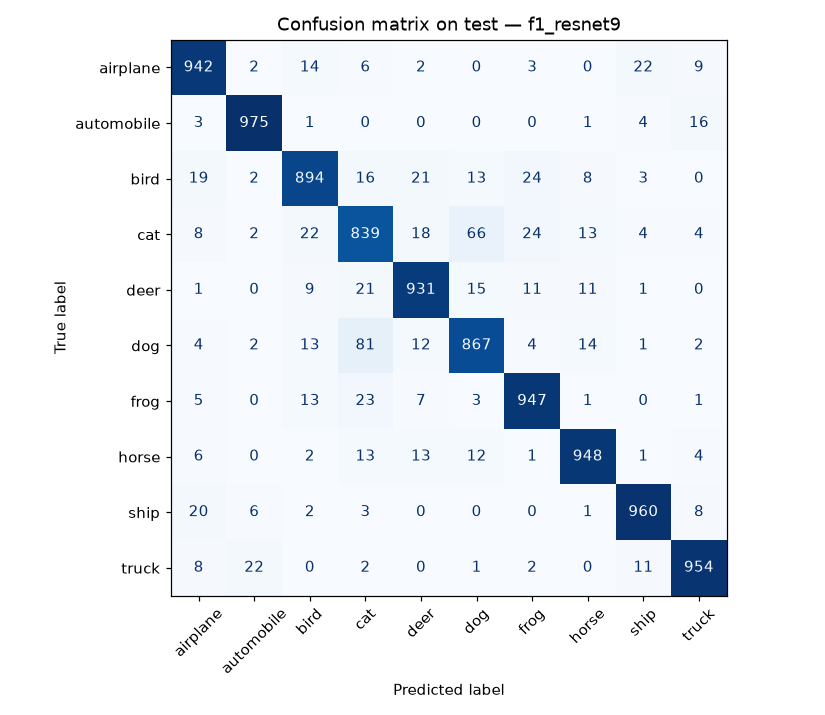
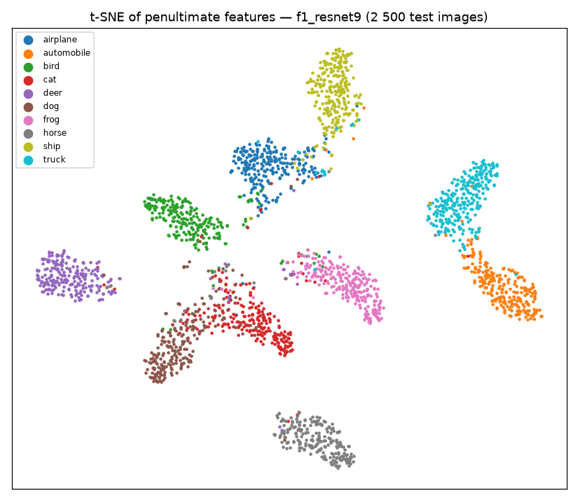

<div align="center">

# CIFAR CNN Ablation

**From a 53% MLP to a 92.6% ResNet-9 on CIFAR-10: 12 models trained from scratch, with one technique changed at a time to measure what it is actually worth.**


English · [Русский](README.ru.md)

</div>

---

## Why this project

Tutorials usually show one good CNN. Here every step from a plain MLP to a residual network is trained under the **same protocol** (45k train / 5k validation / 10k test, model selection on validation only, test touched once). That way each gain can be attributed to a single change: BatchNorm, Dropout, augmentation, the LR schedule, width, attention or residual connections.

<p align="center"></p>

## Results

| Model | What changes | Params | Test acc |
|---|---|---:|---:|
| `e1_mlp` | plain MLP | 3.68 M | 53.0% |
| `e2_simple_cnn` | small CNN | 0.17 M | 70.5% |
| `e4_se_cnn` | + Squeeze-and-Excitation attention | 0.55 M | 72.7% |
| `a1_deep_plain` | deep CNN, no regularisation | 0.81 M | 77.6% |
| `a3_deep_dropout` | + Dropout only | 0.81 M | 81.2% |
| `a2_deep_bn` | + BatchNorm only | 0.82 M | 83.0% |
| `e3_deep_cnn` | + BatchNorm **and** Dropout | 0.82 M | 85.2% |
| `a4_deep_aug` | + crop / flip augmentation | 0.82 M | 86.6% |
| `a6_deep_aug_onecycle` | SGD + OneCycle instead of Adam | 0.82 M | 87.8% |
| `a7_deep_wide_aug_onecycle` | ×2 width | 2.20 M | 90.6% |
| **`f1_resnet9`** | **ResNet-9 + SE + augmentation + OneCycle + label smoothing** | 1.66 M | **92.6%** |

**What each technique was worth** (validation, noise ≈ 0.5 pp):

- **BatchNorm + Dropout together: +7.6 pp.** Without them the deep net hits 98% train accuracy while its validation loss doubles. Each one alone fixes only half of the problem.
- **Augmentation: +1.3 pp**, and overfitting disappears: train accuracy drops below validation.
- **SGD + OneCycle: +1.3 pp. Width ×2: +2.6 pp. Residual connections: +2.5 pp** on top of the wide net, with fewer parameters.
- **SE attention** helps the small net (+1.5 pp) and does nothing for the regularised deep one (−0.2 pp, within noise).

**CIFAR-100.** The same recipe gives **69.6% top-1 / 91.5% top-5** against 57.6% for the deep baseline CNN. 35% of the errors stay inside the correct superclass (≈4% expected by chance): maple ↔ oak ↔ pine, girl ↔ woman ↔ boy.

### Error analysis

- Recall ranges from 83.9% (cat) to 97.5% (automobile). Dog ↔ cat alone accounts for 20% of all errors.
- t-SNE of the penultimate layer shows 10 clean clusters. Only the same confusable pairs touch.
- The 24 most confident mistakes were reviewed by eye ([`13_confident_mistakes.png`](results/figures/13_confident_mistakes.png)). Some are understandable even for a human: a gull over water labelled "ship", a vintage red car labelled "truck".

<p align="center">
  
  
</p>

## What's inside

```text
src/
  data.py          parquet loading, stratified 45k/5k/10k split, normalisation, augmentation
  models.py        MLP, simple / deep CNN, SE blocks, ResNet-9
  train.py         training loop (Adam or SGD + OneCycle, label smoothing, best-epoch on val)
  experiments.py   the 12 experiment configs
  scratch_conv.py  2D convolution and max pooling in NumPy, verified against PyTorch to 1e-15
notebooks/
  cifar10_cnn_study.ipynb   EDA → preprocessing → ablations → error analysis (all outputs saved)
  cifar100_resnet9.ipynb    self-contained CIFAR-100 run, uploads to Kaggle / Colab as one file
results/figures, results/tables   every plot and table used above
REPORT.ru.md                      the full write-up (in Russian)
```

## Run it

```bash
python -m venv .venv && source .venv/bin/activate
pip install -r requirements.txt
```

Download the Hugging Face parquet mirrors [`uoft-cs/cifar10`](https://huggingface.co/datasets/uoft-cs/cifar10) and [`uoft-cs/cifar100`](https://huggingface.co/datasets/uoft-cs/cifar100) into `data/raw/hf_cifar10/{train,test}.parquet` and `data/raw/hf_cifar100/{train,test}.parquet`.

```bash
python -u -m src.experiments          # trains all 12 models (1.5–4 h on an Apple M4 via MPS)
cd notebooks && jupyter nbconvert --to notebook --execute --inplace cifar10_cnn_study.ipynb
```

The notebook reuses weights from `weights/` when they exist, and otherwise retrains. Notebook cells are generated by `notebooks/_build_notebook.py`, so edit the generator rather than the `.ipynb`.

## Limitations

One seed per experiment, 20 epochs per ablation (30 for the final model), and training ran on a laptop in low-power mode, so the timings are pessimistic.

## Related

- [cifar10-image-denoising](https://github.com/AlisherKshtykenov/cifar10-image-denoising): the same CIFAR-10 split and protocol for image restoration (autoencoders, U-Net, DnCNN).

## License

[MIT](LICENSE)
