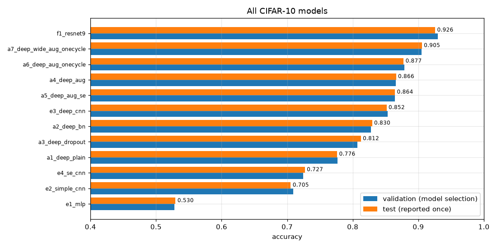
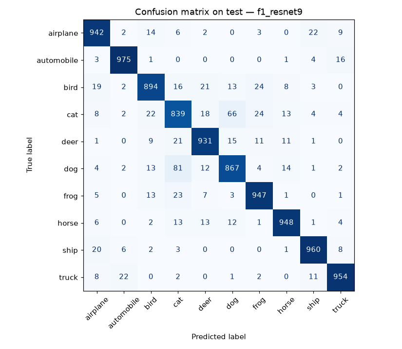
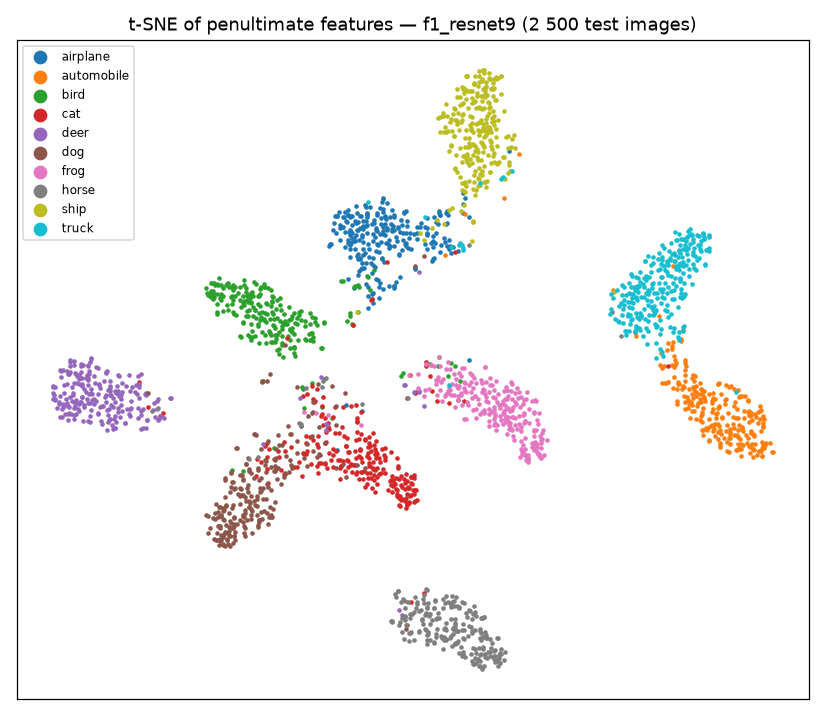

<div align="center">

# CIFAR CNN Ablation

**От MLP с 53% до ResNet-9 с 92.6% на CIFAR-10: 12 моделей обучены с нуля, и в каждой следующей меняется ровно одна техника, чтобы измерить её реальный вклад.**


[English](README.md) · Русский

</div>

---

## Зачем

В туториалах обычно показывают одну хорошую CNN. Здесь каждый шаг от простого MLP до residual-сети обучен по **одному и тому же протоколу**: 45k train / 5k validation / 10k test, модель выбирается только по validation, тест считается один раз. Поэтому каждый прирост можно приписать одному изменению: BatchNorm, Dropout, аугментации, расписанию LR, ширине, attention или residual-связям.

<p align="center"></p>

## Результаты

| Модель | Что меняется | Параметры | Test acc |
|---|---|---:|---:|
| `e1_mlp` | простой MLP | 3.68 M | 53.0% |
| `e2_simple_cnn` | маленькая CNN | 0.17 M | 70.5% |
| `e4_se_cnn` | + Squeeze-and-Excitation attention | 0.55 M | 72.7% |
| `a1_deep_plain` | глубокая CNN без регуляризации | 0.81 M | 77.6% |
| `a3_deep_dropout` | + только Dropout | 0.81 M | 81.2% |
| `a2_deep_bn` | + только BatchNorm | 0.82 M | 83.0% |
| `e3_deep_cnn` | + BatchNorm **и** Dropout | 0.82 M | 85.2% |
| `a4_deep_aug` | + аугментация crop / flip | 0.82 M | 86.6% |
| `a6_deep_aug_onecycle` | SGD + OneCycle вместо Adam | 0.82 M | 87.8% |
| `a7_deep_wide_aug_onecycle` | ширина ×2 | 2.20 M | 90.6% |
| **`f1_resnet9`** | **ResNet-9 + SE + аугментация + OneCycle + label smoothing** | 1.66 M | **92.6%** |

**Вклад каждой техники** (по validation, шум ≈ 0.5 п.п.):

- **BatchNorm + Dropout вместе: +7.6 п.п.** Без них глубокая сеть доходит до 98% на train, а val loss вырастает вдвое. Каждая техника по отдельности решает только половину проблемы.
- **Аугментация: +1.3 п.п.** Переобучение исчезает: train accuracy становится ниже validation.
- **SGD + OneCycle: +1.3 п.п. Ширина ×2: +2.6 п.п. Residual-связи: ещё +2.5 п.п.** поверх широкой сети при меньшем числе параметров.
- **SE attention** помогает маленькой сети (+1.5 п.п.) и ничего не даёт регуляризованной глубокой (−0.2 п.п., в пределах шума).

**CIFAR-100.** Тот же рецепт даёт **69.6% top-1 / 91.5% top-5** против 57.6% у глубокой базовой CNN. 35% ошибок остаются внутри верного суперкласса (случайно было бы около 4%): клён ↔ дуб ↔ сосна, девочка ↔ женщина ↔ мальчик.

### Разбор ошибок

- Recall по классам от 83.9% (cat) до 97.5% (automobile). Одна пара собака ↔ кошка даёт 20% всех ошибок.
- t-SNE предпоследнего слоя показывает 10 чётких кластеров. Соприкасаются только те же путаемые пары.
- 24 самые уверенные ошибки просмотрены глазами ([`13_confident_mistakes.png`](results/figures/13_confident_mistakes.png)). Часть из них понятна и человеку: чайка над водой → «ship», старинная красная машина → «truck».

<p align="center">
  
  
</p>

## Что внутри

```text
src/
  data.py          загрузка parquet, стратифицированное разбиение 45k/5k/10k, нормализация, аугментации
  models.py        MLP, простая и глубокая CNN, SE-блоки, ResNet-9
  train.py         цикл обучения (Adam или SGD + OneCycle, label smoothing, лучшая эпоха по val)
  experiments.py   конфигурации 12 экспериментов
  scratch_conv.py  2D-свёртка и max pooling на NumPy, совпадают с PyTorch до 1e-15
notebooks/
  cifar10_cnn_study.ipynb   EDA → предобработка → ablation → разбор ошибок (все выводы сохранены)
  cifar100_resnet9.ipynb    самодостаточный прогон CIFAR-100, загружается в Kaggle / Colab одним файлом
results/figures, results/tables   все графики и таблицы
REPORT.ru.md                      подробный отчёт
```

## Запуск

```bash
python -m venv .venv && source .venv/bin/activate
pip install -r requirements.txt
```

Скачай parquet-зеркала Hugging Face [`uoft-cs/cifar10`](https://huggingface.co/datasets/uoft-cs/cifar10) и [`uoft-cs/cifar100`](https://huggingface.co/datasets/uoft-cs/cifar100) в `data/raw/hf_cifar10/{train,test}.parquet` и `data/raw/hf_cifar100/{train,test}.parquet`.

```bash
python -u -m src.experiments          # обучает все 12 моделей (1.5–4 ч на Apple M4 через MPS)
cd notebooks && jupyter nbconvert --to notebook --execute --inplace cifar10_cnn_study.ipynb
```

Если в `weights/` есть веса, ноутбук берёт их, иначе обучает модели заново. Ячейки ноутбука генерирует `notebooks/_build_notebook.py`, поэтому править нужно генератор, а не `.ipynb`.

## Ограничения

Один seed на эксперимент, 20 эпох в ablation (30 у финальной модели). Обучение шло на ноутбуке в режиме энергосбережения, поэтому время завышено.

## Лицензия

[MIT](LICENSE)
